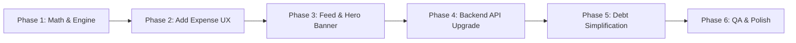

# Step-by-Step Execution Roadmap

## 1. Project Phase Overview

---

## 2. Phase 1: Split Calculation Engine (Math & Client Utilities)

### Goal
Provide a bulletproof mathematical foundation for client-side and server-side calculations with **zero rounding errors** and deterministic penny distribution.

### Detailed Steps:
1. **Create Calculation Utilities**:
   - Create `web/src/features/split-expenses/lib/calculationEngine.ts`.
   - Implement `calculateEqualSplit`, `validateExactSplit`, `calculatePercentageSplit`, and `calculatePartsSplit`.
2. **Deterministic Rounding Guarantee**:
   - Ensure all operations work in integer cents: `Math.round(amount * 100)`.
   - Sort participant IDs deterministically so remainders are allocated in identical order.
3. **Unit Tests**:
   - Add unit tests validating:
     - 100.00 split among 3 people $\to$ 33.34, 33.33, 33.33 (sum = 100.00).
     - Exact amounts matching total vs. displaying remaining balance delta.
     - Percentage calculations summing to 100% with cents rounding.
     - Proportional share division (e.g., 2:1 parts).

---

## 3. Phase 2: Add Expense Dialog Redesign (Splitwise Signature UX)

### Goal
Replace the existing long, rigid web form with Splitwise's high-efficiency interactive sentence workflow.

### Detailed Steps:
1. **Interactive Sentence Bar (`SplitSentenceBar.tsx`)**:
   - Create component displaying `Paid by [You ▾] and split [Equally ▾]`.
   - Add smooth hover glide and scale animations using project motion tokens.
2. **Split Method Selector Dialog (`SplitMethodModal.tsx`)**:
   - Build a 4-tab dialog/drawer:
     - **Tab 1: Equally (`=`)** — Participant checkboxes, live per-person amount pill.
     - **Tab 2: Exact Amounts (`123`)** — Number inputs per participant with live delta indicator (`Rs. X remaining` / `Rs. Y over`).
     - **Tab 3: Percentages (`%`)** — Percentage inputs with 100% progress gauge.
     - **Tab 4: By Shares (`👥`)** — Increment/decrement stepper (`-` / `+`) for parts.
   - Disable confirmation button unless validation passes.
3. **Smart Category Auto-Detection**:
   - As user enters expense title (e.g. *"Lunch"*, *"Petrol"*, *"Hotel"*), automatically suggest the matching category icon and select it.
4. **Integration into `AddExpenseDialog.tsx` & `EditExpenseDialog.tsx`**:
   - Replace old participants list with the new `useSplitCalculator` hook and sentence bar.
   - Preserve backward compatibility with existing API payload.

---

## 4. Phase 3: Group View & Activity Feed Overhaul

### Goal
Transform `SplitGroupDetailsPage.tsx` from an overwhelming accounting table into an intuitive Splitwise-style personal ledger.

### Detailed Steps:
1. **Group Hero Balance Banner (`GroupHeroBalanceBanner.tsx`)**:
   - Prominent status card at top of group:
     - Green (`text-inflow`, `bg-inflow-muted/20`) when you are owed.
     - Orange/Red (`text-outflow`, `bg-outflow-muted/20`) when you owe.
     - Neutral when settled.
2. **Splitwise 3-Column Expense Feed Item (`ExpenseFeedItem.tsx`)**:
   - Column 1: Date block (`NOV 16`) + Category Icon with pastel background.
   - Column 2: Expense Title + Subtitle (*"You paid Rs. 3,600"* or *"Ali paid Rs. 3,600"*).
   - Column 3: Personal financial ledger impact:
     - `YOU LENT +Rs. 2,400.00` (inflow green).
     - `YOU BORROWED -Rs. 1,200.00` (outflow red).
     - `NOT INVOLVED Rs. 0.00` (muted gray).
3. **Chronological Monthly Grouping**:
   - Group expenses by Month & Year (`NOVEMBER 2026`, `OCTOBER 2026`) with clean sticky dividers.
4. **Decompose `SplitGroupDetailsPage.tsx`**:
   - Break the monolithic 1,930-line file into:
     - `GroupHeroBalanceBanner.tsx`
     - `GroupActionToolbar.tsx`
     - `ExpenseFeed.tsx`
     - `BalancesDrawer.tsx`
     - `GroupActivityDrawer.tsx`

---

## 5. Phase 4: Backend Domain & API Upgrade

### Goal
Enhance .NET 8 Web API to natively support non-equal splits, detailed share auditing, and multi-payer data.

### Detailed Steps:
1. **Domain Enums & Entities**:
   - Add `SplitCalculationType` enum (`Equal`, `Exact`, `Percentage`, `Shares`).
   - Add `SplitExpenseShare` entity fields (`ShareParts`, `Percentage`, `ExactAmount`).
2. **Expand `ISplitCalculatorService`**:
   - Implement `CalculateExactSplit`, `CalculatePercentageSplit`, and `CalculateSharesSplit` in `SplitCalculatorService.cs`.
3. **Update `CreateSplitExpenseDto` & Controller**:
   - Add `SplitType` and `ParticipantSplits` fields.
   - Retain `ParticipantUserIds` fallback for backward compatibility.
4. **Database Migration**:
   - Generate EF Core migration or script updating `SplitExpenses` and `SplitExpenseShares` tables.

---

## 6. Phase 5: Debt Simplification & Settle-Up Flow

### Goal
Implement Splitwise's "Simplify Debts" algorithm to eliminate circular transactions and make settling up effortless.

### Detailed Steps:
1. **Min-Cash-Flow Debt Simplifier**:
   - Implement greedy bipartite matching algorithm on net balances.
   - Backend service: `IDebtSimplifierService.cs`.
   - Client-side fallback utility in `calculationEngine.ts`.
2. **Simplified Debts View (`SimplifiedDebtsDrawer.tsx`)**:
   - Visual flow: `Usman -> Ali: Rs. 2,500` instead of 5 separate back-and-forth payments.
3. **Streamlined Settle-Up Sheet (`SettleUpDialog.tsx`)**:
   - Selecting a member automatically pre-fills the exact net debt.
   - Quick one-click "Record Cash Settlement" button.
   - Seamless transition to existing confirmation state machine (`PendingReceiver`).

---

## 7. Phase 6: Quality Assurance, Verification & Polish

### Detailed Steps:
1. **Type Checking & Linting**:
   - Run `npx tsc --noEmit` inside `web/` to guarantee zero TypeScript errors.
   - Run `dotnet build` to ensure .NET compilation passes.
2. **Mobile & Desktop Responsive Verification**:
   - Check touch targets (minimum 44x44px for pills and buttons on mobile).
   - Test bottom drawer scrolling on iOS Safari and Android Chrome.
3. **Theme & Accessibility**:
   - Verify WCAG 2.2 AA contrast in both light and dark modes.
   - Ensure all financial amounts use `font-mono tabular-nums`.
   - Respect `useMotionSafe()` so users with `prefers-reduced-motion` get gentle opacity fades without aggressive layout shifts.
