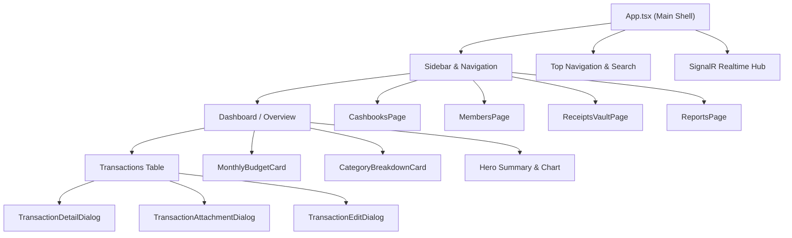

# Spendwise UI & Component Architecture Documentation

This document provides a comprehensive guide to all user interface (UI) components, design patterns, permission-gated controls, and interactive modules across the Spendwise web application.

---

## 1. High-Level UI Architecture & Layout

Spendwise is built with React 19, TypeScript, and Vite. The design philosophy centers around high information density, clean financial typography, real-time feedback via SignalR, and owner-controlled security gating.

---

## 2. Core Navigation & Workspace Shell (`App.tsx`)

### 2.1 Sidebar Navigation
- **Workspace Switcher:** Dropdown menu allowing instant switching between active business workspaces.
- **Navigation Links:**
  - **Overview / Dashboard:** Main transaction stream, balances, and quick stats.
  - **Cashbooks:** Grid view of all financial books within the business.
  - **Members & Access:** Team directory, invitations, and permission administration.
  - **Receipts Vault:** Central document gallery of analyzed and scanned receipts.
  - **Financial Reports:** Analytics, charts, and downloadable summaries.
- **Active User Profile:** Shows authenticated user avatar, full name, email, and a quick sign-out button.

### 2.2 Top Header & Search Bar
- **Global Search (`Ctrl+K` / `Cmd+K`):** Instant search bar allowing filtering of notes, merchants, or categories.
- **Cashbook Selector Dropdown:** Quick-switch between cashbooks directly from the navigation bar.
- **Role Badge Pill:** Displays the user's authority level in the active cashbook:
  - `👑 Cashbook Owner`: Golden pill with crown icon indicating complete administrative authority.
  - `🛡️ Invited Member`: Soft blue pill indicating assigned collaborator rights.
- **Real-Time Notification Bell (`NotificationsPopover.tsx`):**
  - Displays incoming SignalR alerts (invitations, transaction creations, updates, or deletions).
  - Unread badge counter with live polling fallback.

---

## 3. Team & Permission Security (`MembersPage.tsx`)

The Members and Access Control page implements the strict **Owner-Controlled Security Model**.

### 3.1 Scope Toggle (`Business` vs `Cashbook`)
- **Cashbook Scope:** Inspect and manage permissions specifically tied to the active or chosen cashbook.
- **Business Scope:** Manage workspace-level members with access across all books.

### 3.2 Owner View: Invite Teammate Panel
- **Scope Selection:** Toggle between granting access to the entire business or a specific cashbook.
- **Permission Presets:** Instant one-click selection buttons:
  - `Full Access`: Grants View, Add, Edit, and Delete.
  - `Add & Edit`: Grants View, Add, and Edit (Delete restricted).
  - `Add Only`: Grants View and Add.
  - `View Only`: Grants read-only visibility.
- **Interactive Permission Cards:** Each capability is presented with an explanatory description:
  - `View cashbook`: Browse cashbook in workspace lists.
  - `View transactions`: Inspect entries, amounts, dates, and attachments.
  - `Add transactions`: Record new cash entries and scan receipts.
  - `Edit transactions`: Modify remarks, dates, and attachments.
  - `Delete transactions`: Permanently remove entries from the database.
- **Owner Security Callout:** Explanatory banner emphasizing that only the Cashbook Owner can assign, modify, or revoke permissions.

### 3.3 Invited Member View: "Your Cashbook Access" Card
When an invited member views this page:
- The invite form is replaced with a transparent **Assigned Capabilities Matrix**.
- Each capability displays a live status:
  - `Allowed` (Green checkmark): Explicitly granted by the Owner.
  - `Restricted` (Lock badge): Not granted; operations will be rejected with HTTP 403 Forbidden.
- Includes guidance on requesting permission elevation from the Cashbook Owner.

### 3.4 Member Directory & Permission Editor
- **Live Search Bar:** Instant filtering of teammates by name or email.
- **Member Cards:**
  - Displays user avatar, full name, email, and status (`Active`, `Pending`, `Revoked`).
  - `You` badge for the current authenticated user.
  - Color-coded permission chips:
    - View: Soft emerald (`#ecfdf5`)
    - Add: Soft blue (`#eff6ff`)
    - Edit: Soft amber (`#fffbeb`)
    - Delete: Soft rose (`#fff1f2`)
- **Inline Permission Drawer (`MemberPermissionEditor`):**
  - Accessible only by the Cashbook Owner for other members.
  - Provides inline preset toggles, custom checkboxes, live error handling, and save indicators.
  - Self-editing is completely forbidden and hidden.

### 3.5 Invitations Management
- **Invitations for You:** Shows pending invites with cashbook name, inviter name, and granted permission preview chips, alongside Accept and Decline buttons.
- **Sent Invitations (Owner Only):** Status filters (`All`, `Pending`, `Accepted`, `Revoked`), permission preview, a **Copy Link** button for sharing tokens, and a Revoke action for pending invitations.

---

## 4. Cashbooks Management (`CashbooksPage.tsx`)

### 4.1 KPI Summary Banner
- **Total Cashbooks:** Total number of books in the current business.
- **Current Active Book:** Highlight of the cashbook currently driving the dashboard.
- **Entries in Active Book:** Quick count of all transactions logged in that book.

### 4.2 Cashbook Cards Grid
- **Card Header:** Book category icon with `Active` or `Standard` status pills.
- **Card Body:** Cashbook title, creation metadata, and parent business reference.
- **Action Buttons:**
  - `Transactions →`: Navigates directly into the transaction ledger for that book.
  - `Set as Active`: Switches the global working cashbook.
  - `Rename` & `Delete`: Permission-gated action buttons (disabled or hidden for non-owners lacking `CASHBOOK_UPDATE` or `CASHBOOK_DELETE`).

---

## 5. Transactions Stream & Ledger (`App.tsx` & `TransactionDetailDialog.tsx`)

### 5.1 Overview Transactions Table
- **Category Icons & Type Indicators:** Distinct visual styling for `Cash In` (green inflow arrow) and `Cash Out` (red/orange outflow arrow).
- **Metadata Column:**
  - Transaction remarks / note.
  - Category pill.
  - **Author Badge (`👤 Recorded by <Name>`):** Highlights the user who recorded the transaction in the database.
  - **Receipt Attachment Chip:** Indicates attached image or invoice with click-to-preview action.
- **Permission-Gated Action Buttons:**
  - If member has neither Edit nor Delete rights: Displays a subtle `🔒 Read only` pill.
  - If member lacks Delete permission: Delete action is omitted or restricted.
  - If member lacks Edit permission: Edit action is omitted or restricted.

### 5.2 Transaction Detail Dialog (`TransactionDetailDialog.tsx`)
A modal dialog opened by clicking any transaction row:
- **Hero Amount Banner:** Large currency display with color-coded background and category indicator.
- **Metadata Cards Grid:**
  - **Transaction Date:** Formatted date, time, and relative timestamp (e.g., `Today`, `Yesterday`).
  - **Cashbook & Workspace:** Target book and business workspace.
  - **Recorded By:** Full author attribution with `Author` badge.
  - **Transaction ID:** Reference identifier with an instant copy-to-clipboard button.
- **Notes & Description Box:** Clean card displaying full remarks.
- **Receipt Attachment Section:** Thumbnail/file pill with an external viewer button.
- **Footer Actions:**
  - If allowed: `Delete` (danger button) and `Edit` (secondary button).
  - If restricted: `🔒 Delete restricted` and `🔒 Edit restricted` pills with descriptive tooltips.

---

## 6. Budget & Analytics Components

### 6.1 `MonthlyBudgetCard.tsx`
- Interactive card monitoring current monthly spend against configured budget thresholds.
- Dynamic color progress bar (green < 75%, amber 75–90%, red > 90%).
- Surplus / Deficit forecasting based on daily expenditure pace.

### 6.2 `CategoryBreakdownCard.tsx`
- Donut chart and percentage breakdown across spending categories (Food, Utilities, Travel, Supplies, etc.).
- Direct link to filter the transactions list by the selected category.

### 6.3 `ReportsPage.tsx`
- Comprehensive date-range financial summaries.
- Visual bar and trend line charts showing cash inflow vs. cash outflow.
- Export capabilities for accountant and bookkeeping review.

---

## 7. Modal Dialogs & Utilities

| Component | Purpose | Permissions Gated |
| :--- | :--- | :--- |
| `CreateBusinessDialog.tsx` | Creates a new workspace / company account | Workspace creation permissions |
| `BudgetConfigDialog.tsx` | Sets monthly cash limits per cashbook | Owner / Update permission |
| `TransactionAttachmentDialog.tsx` | High-resolution viewer with zoom & download for receipts | View permission |
| `FinancialStatementModal.tsx` | Printable ledger summary and balance breakdown | View permission |
| `UserProfileDialog.tsx` | Profile details, password reset, and personal settings | Authenticated user |
| `KeyboardShortcutsDialog.tsx` | Quick keyboard shortcut reference modal | Accessible globally (`Ctrl+/`) |

---

## 8. Summary of Security & Gating Rules in UI

1. **Owner Authority:** Cashbook creators and business owners have complete administrative rights across all controls.
2. **Strict Member Gating:** Non-owner actions (Add, Edit, Delete, Invite) are dynamically hidden or disabled based on database-persisted permissions retrieved via `/api/MemberManagement/businesses/{id}/access`.
3. **No Client-Side Bypasses:** All actions in the UI mirror server-side checks. Even if UI controls are manipulated, the backend strictly returns `HTTP 403 Forbidden`.
